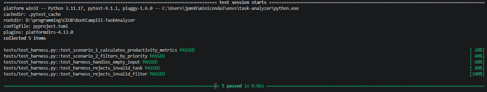
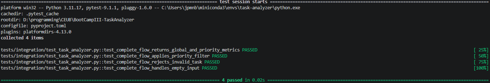
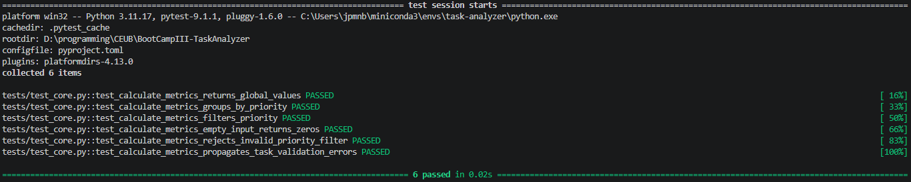
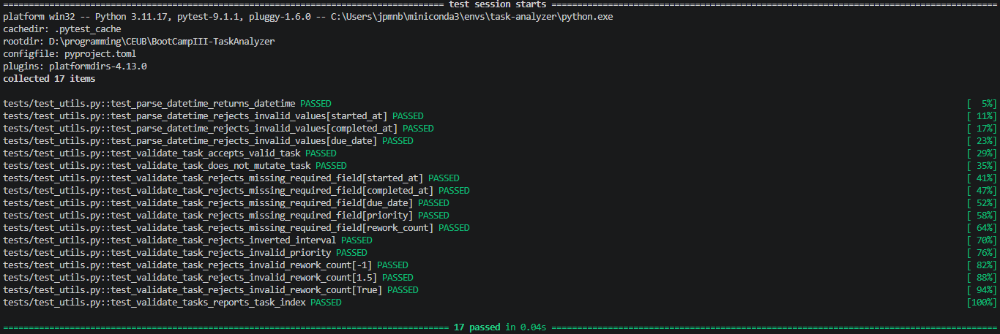

# TaskAnalyzer

Módulo Python para análise de produtividade de tarefas em memória, conforme a
especificação técnica em [`specs/task_analyzer_spec.md`](specs/task_analyzer_spec.md).

## Requisitos

- Conda ou Anaconda
- Python 3.11 ou superior

## Configuração do ambiente

Crie o ambiente Conda definido no repositório:

```bash
conda env create -f environment.yml
conda activate task-analyzer
```

Se o ambiente já existir, atualize as dependências com:

```bash
conda env update -f environment.yml --prune
```

## Execução dos testes

Com o ambiente ativado, execute:

```bash
pytest
```

A configuração do projeto utiliza o layout `src/`, portanto o pacote
`task_analyzer` é carregado a partir de `src/task_analyzer`.

## Estrutura do projeto

```text
BootCampIII-TaskAnalyzer/
├── .github/workflows/       # Pipeline CI/CD
├── Dockerfile               # Imagem Docker com ambiente Conda isolado
├── .dockerignore             # Exclusões do contexto de build Docker
├── docs/evidence/           # Evidências visuais da execução dos testes
│   ├── tests_harness.png
│   ├── tests_integracao.png
│   ├── tests_unitario_metricas.png
│   └── tests_unitario_validacoes.png
├── docs/governance_report.md # Fonte do relatório de governança de IA
├── docs/governance_report.pdf # Relatório de governança de IA
├── environment.yml          # Ambiente Conda e ferramentas de qualidade
├── pyproject.toml           # Build, Pytest e Pylint
├── specs/                   # Especificações e plano de ação
├── src/task_analyzer/       # Pacote principal
│   ├── core.py              # Métricas analíticas
│   └── utils.py             # Validações e auxiliares
└── tests/                   # Testes unitários e de integração
    ├── integration/
    │   └── test_task_analyzer.py # Testes de integração
    ├── test_core.py          # Testes das métricas
    ├── test_harness.py       # Cenários avaliativos e casos de borda
    └── test_utils.py         # Testes das validações
```

## Status da implementação

- **Implementação 1 — Build e estrutura inicial:** concluída.
- **Implementação 2 — Validações e utilitários:** concluída.
- **Pipeline CI/CD:** configurado em `.github/workflows/ci.yml`.
- **Implementação 3 — Métricas analíticas:** concluída na branch
  `feature/implement-productivity-metrics`.
- **Implementação 4 — Testes de integração:** concluída na branch
  `feature/implement-integration-tests`.
- **Implementação 5 — Pipeline CI/CD completo:** concluída na branch
  `feature/complete-ci-pipeline`.
- **Implementação 6 — Documentação e revisão final:** concluída na branch
  `docs/finalize-documentation`.
- **Implementação 7 — Conformidade dos requisitos avaliativos:** concluída na
  branch `audit/evaluation-requirements`.
- **Implementação 8 — Pipeline, Docker e governança de IA:** em andamento na
  branch `feature/containerization-governance-pipeline`.

Na segunda implementação, `task_analyzer.utils` passou a validar tarefas sem
alterar os dados recebidos. A validação interrompe na primeira inconsistência e
lança `ValueError` com uma mensagem contextualizada. São verificados os campos
obrigatórios, datas ISO 8601, coerência entre início e conclusão, prioridades e
contagem de retrabalho.

Os testes unitários podem ser executados com:

```bash
pytest tests/test_utils.py
pytest tests/test_core.py
pytest tests/integration/test_task_analyzer.py
```

Para executar toda a suíte:

```bash
python -m pytest
```

As métricas analíticas retornam `average_completion_time` em horas decimais,
`delay_rate` e `rework_rate` como percentuais de 0 a 100, além de métricas
equivalentes em `by_priority` para `ALTA`, `MEDIA` e `BAIXA`. O filtro
`priority_filter` aceita `TODAS`, `None` ou uma prioridade específica.

Os testes de integração validam o fluxo completo entre entrada, validação,
cálculo das métricas, filtros de prioridade, entradas inválidas e conjunto
vazio.

## Containerização Docker

A execução isolada utiliza a imagem oficial `continuumio/miniconda3` e cria o
ambiente Conda definido em `environment.yml`:

```bash
docker build -t task-analyzer:0.8.0 .
docker run --rm task-analyzer:0.8.0
```

O comando `docker run` executa toda a suíte Pytest dentro do container.

## Governança de IA

As regras de governança estão descritas em
[`CONTEXT_RULES.md`](CONTEXT_RULES.md). O relatório desta implementação está
disponível em [Markdown](docs/governance_report.md) e em
[PDF](docs/governance_report.pdf).

## Evidências de execução dos testes

As imagens abaixo registram a execução local dos testes com Python 3.11.17
e Pytest. Os arquivos estão versionados em
[`docs/evidence/`](docs/evidence/).

### Harness avaliativo

Os dois cenários avaliativos e os casos de borda foram aprovados:



### Testes de integração

O fluxo completo de entrada, validação e cálculo das métricas foi aprovado:



### Testes unitários das métricas

Os cálculos globais, agrupamentos, filtros e validações de métricas foram
aprovados:



### Testes unitários das validações

As validações de datas, campos obrigatórios, prioridades e retrabalho foram
aprovadas:



## Build, importação e qualidade

Com o ambiente `task-analyzer` ativado:

```bash
python -m build
python -m pip install --force-reinstall dist/*.whl
python -c "import task_analyzer; print(task_analyzer.__version__)"
python -m pylint src tests --fail-under=8.0
```

A versão atual do pacote é `0.8.0`. Os comandos de build geram artefatos em
`build/` e `dist/`, que são ignorados pelo Git.

## Pipeline CI/CD

O workflow `.github/workflows/ci.yml` é executado em `push` e
`pull_request` direcionados às branches `main` e `master`. Ele:

1. Configura o ambiente Conda definido em `environment.yml`.
2. Executa toda a suíte com `python -m pytest`.
3. Verifica a sintaxe Python em `src/` e `tests/` com `compileall`.
4. Constrói os artefatos do pacote com `python -m build`.
5. Confirma a importação do pacote e a versão `0.8.0`.
6. Executa Pylint com nota mínima `8.0`.
7. Constrói a imagem Docker.
8. Executa a suíte de testes dentro do container.

## Plano de implementação

As etapas serão executadas individualmente, mediante autorização:

1. **Build e estrutura inicial:** concluída.
2. **Validações e utilitários:** concluída.
3. **Métricas analíticas:** concluída; contrato de
   `calculate_productivity_metrics` implementado e coberto por testes
   unitários.
4. **Integração:** concluída; fluxo completo coberto por testes de integração
   sem persistência em disco.
5. **Pipeline:** concluído; GitHub Actions configurado com Conda, Pytest,
   verificação de sintaxe, build, importação e Pylint.
6. **Documentação e revisão final:** concluída; documentação, contrato,
   comandos de reprodução e critérios de aceitação revisados.
7. **Conformidade dos requisitos avaliativos:** concluída; harness avaliativo,
   documentação da estrutura e verificação dos critérios.
8. **Pipeline, Docker e governança de IA:** em andamento; revisão do pipeline,
   containerização isolada, relatório de governança e alinhamento documental.

Nenhuma etapa posterior altera o contrato público sem autorização explícita.
